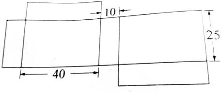

# Mathematics (Grade 5)

**ID**: 7fd759b6
**难度**: medium_hard
**题型**: short_answer

## 题目
如图是一个长方体纸盒的平面展开图，这个纸盒的表面积是多少平方厘米？（单位：cm）

## 解答

**答案**: 3300

1. Step1:根据长方体展开图确定长方体的长为40厘米，宽为25厘米，高为10厘米
2. Step2:明确长方体表面积公式为s=(ab + ah + bh)×2，其中a为长，b为宽，h为高
3. Step3:将长a = 40厘米，宽b = 25厘米，高h = 10厘米代入公式，得到(40×25 + 40×10 + 25×10)×2
4. Step4:先计算括号内的值，40×25 = 1000，40×10 = 400，25×10 = 250，括号内结果为1000 + 400 + 250 = 1650
5. Step5:再计算1650×2 = 3300平方厘米

## 知识点

**知识点**:
  - 长方体和正方体的表面积

---
