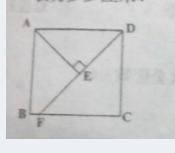

# Mathematics (Grade 5)

**ID**: 829ff662
**难度**: medium_hard
**题型**: short_answer

## 题目
如图，正方形ABCD的边长为4厘米，DF=5厘米，AE垂直DF于点E，AE的长为多少厘米？

## 解答

**答案**: 3.2

1. Step1:连接AF
2. Step2:在Rt△DFC中，因为正方形ABCD边长为4厘米，DF = 5厘米，根据勾股定理可得FC = $\sqrt{5² - 4²}$ = 3厘米
3. Step3:计算BF的长度，BF = 4 - 3 = 1厘米
4. Step4:在△ABF中，根据勾股定理计算AF的长度，AF = $\sqrt{AB² + BF²}$ = $\sqrt{4² + 1²}$ = $\sqrt{17}$厘米
5. Step5:计算△AFD的面积，S△AFD = 4×4 - 3×4÷2 - 4×1÷2 = 16 - 6 - 2 = 8平方厘米
6. Step6:根据三角形面积公式S = 0.5×底×高，对于△AFD，0.5×FD×AE = 8，已知FD = 5厘米，可得AE = 8×2÷5 = 3.2厘米

## 知识点

**知识点**:
  - --

---
