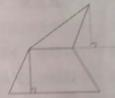

# Mathematics (Grade 5)

**ID**: 82c2e63c
**难度**: medium_hard
**题型**: short_answer

## 题目
如图，一块钢板是由一个梯形和一个三角形组成的，梯形的上底和高均与三角形的高相等，都是梯形下底的一半.梯形的下底是8dm，这块钢板的面积是多少平方分米？

## 解答

**答案**: 32

1. Step1:根据已知条件，计算梯形的上底，因为梯形的上底是下底的一半，下底是8dm，所以上底为8÷2 = 4dm
2. Step2:计算三角形的面积，三角形的底和高均为4dm，根据三角形面积公式底×高÷2，可得面积为4×4÷2 = 8平方分米
3. Step3:计算梯形的面积，梯形上底为4dm，下底为8dm，高为4dm，根据梯形面积公式(上底+下底)×高÷2，可得面积为(4 + 8)×4÷2 = 24平方分米
4. Step4:计算钢板总面积，即三角形面积与梯形面积之和，8 + 24 = 32平方分米

## 知识点

**知识点**:
  - --

---
