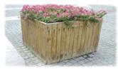

# Mathematics (Grade 5)

**ID**: 8635e643
**难度**: medium_hard
**题型**: short_answer

## 题目
一个花坛（如图），底面边长1.2米的正方形，四周用木条围成，高0.9米．
（1）这个花坛占在多少平方米？
（2）用泥土填满这个花坛，大约需要多少立方米泥土？（木条的厚度忽略不计）
（3）做这样一个花坛，四周大约需要多少平方米木条？

## 解答

**答案**: 1.44, 1.296, 4.32

1. Step1:计算花坛占地面积，根据占多少面积就是求底面正方形的面积，可得面积为1.2×1.2 = 1.44平方米
2. Step2:计算填满花坛所需泥土体积，因为用泥土填满这个花坛就是求这个长方体的体积，所以体积为1.2×1.2×0.9 = 1.296立方米
3. Step3:计算做花坛四周所需木条面积，由于四周大约需要木条面积就是求这个长方体的四个侧面的面积，所以面积为1.2×0.9×4 = 4.32平方米

## 知识点

**知识点**:
  - 长方体、正方体表面积与体积计算的应用．

---
