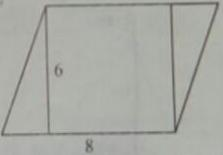

# Mathematics (Grade 5)

**ID**: 8789e8ee
**难度**: medium_hard
**题型**: short_answer

## 题目
如图，一个平行四边形的底是8分米，高是6分米，把它剪成一个正方形和两个相等的三角形，每个三角形的面积是多少平方分米？

 6
 8

## 解答

**答案**: 6

1. Step1:根据平行四边形面积公式S=底×高，计算平行四边形面积为8×6 = 48平方分米
2. Step2:根据正方形面积公式S=边长×边长，计算正方形面积为6×6 = 36平方分米
3. Step3:计算两个三角形的面积和为平行四边形面积减去正方形面积，即48 - 36 = 12平方分米
4. Step4:因为两个三角形面积相等，所以每个三角形面积为两个三角形面积和除以2，即12÷2 = 6平方分米

## 知识点

**知识点**:
  - --

---
