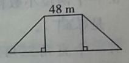

# Mathematics (Grade 5)

**ID**: 896d9c47
**难度**: medium_hard
**题型**: short_answer

## 题目
一块梯形地(如图)可以看成是由一个正方形和两个等腰直角三角形拼成的.已知正方形的边长是48米，在这块地里种辣椒，每棵辣椒占地0.08平方米，一共可以种多少棵辣椒？

 48m

## 解答

**答案**: 57600

1. Step1:计算梯形的上底，上底等于正方形的边长，为48米
2. Step2:计算梯形的下底，下底为正方形边长加上两个等腰直角三角形的直角边长度，等腰直角三角形直角边等于正方形边长，所以下底是48 + 48 = 96米
3. Step3:计算梯形的高，高等于正方形的边长，为48米
4. Step4:根据梯形面积公式S=(a + b)×h÷2（其中a为上底，b为下底，h为高），计算梯形地面积，即(48 + 96)×48÷2 = 144×48÷2 = 6912÷2 = 3456平方米
5. Step5:已知每棵辣椒占地0.08平方米，用梯形地面积除以每棵辣椒占地面积，即3456÷0.08 = 57600棵

## 知识点

**知识点**:
  - --

---
