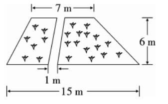

# Mathematics (Grade 5)

**ID**: 8b5bc429
**难度**: medium_hard
**题型**: short_answer

## 题目
在一块梯形草坪中有一条宽1m的小路（如图） ，草地的面积有多大？

## 解答

**答案**: 60

1. Step1:根据梯形面积公式$S=(a + b)h÷2$（其中$a$为上底，$b$为下底，$h$为高），计算梯形的面积，这里$a = 7$米，$b = 15$米，$h = 6$米，所以梯形面积为$(7 + 15)×6÷2 = 66$平方米
2. Step2:根据平行四边形面积公式$S = ah$（其中$a$为底，$h$为高），计算小路的面积，这里$a = 1$米，$h = 6$米，所以小路面积为$1×6 = 6$平方米
3. Step3:用梯形的面积减去小路的面积得到草地的面积，即$66 - 6 = 60$平方米

## 知识点

**知识点**:
  - 组合图形的面积

---
