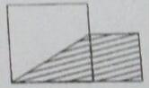

# Mathematics (Grade 5)

**ID**: 8dd85823
**难度**: medium_hard
**题型**: short_answer

## 题目
下面是两个个正方形组成的图形，已知小正方形的边长为6厘米，大正方形的边长为10厘米，求空白部分的面积．

## 解答

**答案**: 70

1. Step1:根据正方形面积公式，大正方形面积为边长乘以边长，即10×10 = 100平方厘米
2. Step2:根据三角形面积公式，三角形面积为底乘以高除以2，此三角形底为10厘米，高为6厘米，面积为10×6÷2 = 30平方厘米
3. Step3:因为空白部分的面积等于大正方形面积减去三角形的面积，所以空白部分面积为100 - 30 = 70平方厘米

## 知识点

**知识点**:
  - --

---
