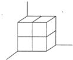

# Mathematics (Grade 5)

**ID**: 8f0cd4f6
**难度**: medium_hard
**题型**: short_answer

## 题目
4个棱长都是30厘米的正方体堆放在墙角处．露在外面的面积是多少？

## 解答

**答案**: 7200

1. Step1:分析图形可知，前面外露4个面，上面外露2个面，右面外露2个面，所以露在外面的面一共有4 + 2 + 2 = 8个
2. Step2:已知正方体棱长为30厘米，根据正方形面积公式s = a²，其中a = 30厘米，可得一个面的面积为30×30 = 900平方厘米
3. Step3:因为露在外面的面有8个，且一个面面积为900平方厘米，所以露在外面的面积为900×8 = 7200平方厘米

## 知识点

**知识点**:
  - 长方体和正方体的表面积；从不同方向观察物体和几何体．

---
