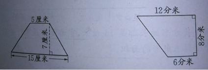

# Mathematics (Grade 5)

**ID**: 8fa43354
**难度**: medium_hard
**题型**: short_answer

## 题目
计算下面每个梯形的面积．

 5厘米  7厘米  15厘米                           12分米  8分米  6分米

## 解答

**答案**: 170, 60

1. Step1:对于第一个梯形，确定上底为5厘米，下底为15厘米，高为17厘米。根据梯形面积公式S=(上底+下底)×高÷2，可得面积为(5 + 15)×17÷2。
2. Step2:先计算括号内5 + 15 = 20，得到20×17÷2。
3. Step3:计算20×17 = 340，得到340÷2。
4. Step4:计算340÷2 = 170平方厘米。
5. Step5:对于第二个梯形，确定上底为12分米，下底为8分米，高为6分米。根据梯形面积公式S=(上底+下底)×高÷2，可得面积为(12 + 8)×6÷2。
6. Step6:先计算括号内12 + 8 = 20，得到20×6÷2。
7. Step7:计算20×6 = 120，得到120÷2。
8. Step8:计算120÷2 = 60平方分米。
9. Step9:将两个梯形面积按顺序整理为['170', '60']

## 知识点

**知识点**:
  - --

---
