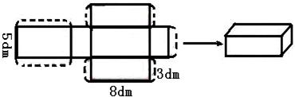

# Mathematics (Grade 5)

**ID**: 8fb7359c
**难度**: medium_hard
**题型**: short_answer

## 题目
如图，是长方体的展开图，量出有关数据，求出这个长方体的表面积和体积．

## 解答

**答案**: 158, 120

1. Step1:根据展开图确定长方体的长为8分米、宽为5分米、高为3分米
2. Step2:根据长方体表面积公式S=(ab + bh + ah)×2，其中a = 8，b = 5，h = 3，计算(8×5 + 5×3 + 3×8)×2=(40 + 15 + 24)×2=79×2=158平方分米
3. Step3:根据长方体体积公式V = abh，其中a = 8，b = 5，h = 3，计算8×5×3=40×3=120立方分米

## 知识点

**知识点**:
  - 长方体和正方体的体积;长方体的展开图;长方体和正方体的表面积

---
