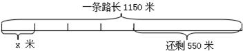

# Mathematics (Grade 5)

**ID**: 9094c2fc
**难度**: medium_hard
**题型**: short_answer

## 题目
看图列方程，并求出x的值．

## 解答

**答案**: 150

1. Step1:根据图示可知x的4倍加上还剩下的550米等于这条路的长度1150米，列出方程4x + 550 = 1150
2. Step2:方程两边同时减去550，得到4x + 550 - 550 = 1150 - 550，化简为4x = 600
3. Step3:方程两边同时除以4，得到4x÷4 = 600÷4，解得x = 150

## 知识点

**知识点**:
  - 列方程解应用题（两步需要逆思考）

---
