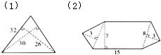

# Mathematics (Grade 5)

**ID**: 9612b038
**难度**: medium_hard
**题型**: short_answer

## 题目
求图形面积．(单位：厘米)

## 解答

**答案**: 416, 129

1. Step1:对于第一个三角形，根据三角形面积公式底×高÷2，底为32厘米，高为26厘米，计算其面积为32×26÷2=416平方厘米
2. Step2:对于第二个图形，先计算两边三角形面积，单个三角形面积为8×3÷2，有两个这样的三角形，面积为8×3÷2×2；再计算中间平行四边形面积为15×7
3. Step3:将两边三角形面积与中间平行四边形面积相加，8×3÷2×2+15×7=24+105=129平方厘米

## 知识点

**知识点**:
  - 组合图形的面积;三角形的周长和面积．

---
