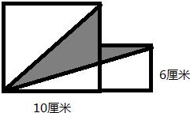

# Mathematics (Grade 5)

**ID**: 9712e486
**难度**: medium_hard
**题型**: short_answer

## 题目
如图是由两个正方形组成的图形，已知大正方形的边长为10厘米，小正方形的边长为6厘米，求阴影部分的面积．

## 解答

**答案**: 38

1. Step1:计算大正方形的面积，根据正方形面积公式S=a²（a为边长），可得大正方形面积为10×10 = 100平方厘米
2. Step2:计算小正方形的面积，根据正方形面积公式可得小正方形面积为6×6 = 36平方厘米
3. Step3:计算两个正方形的面积和，即100 + 36 = 136平方厘米
4. Step4:计算第一个空白三角形的面积，其底为10 + 6厘米，高为6厘米，根据三角形面积公式S=ah÷2（a为底，h为高），可得其面积为6×(10 + 6)÷2 = 48平方厘米
5. Step5:计算第二个空白三角形的面积，其底和高均为10厘米，根据三角形面积公式可得其面积为10×10÷2 = 50平方厘米
6. Step6:计算两个空白三角形的面积和，即48 + 50 = 98平方厘米
7. Step7:用两个正方形的面积和减去两个空白三角形的面积和，即136 - 98 = 38平方厘米，得到阴影部分面积

## 知识点

**知识点**:
  - 组合图形的面积

---
