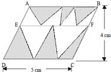

# Mathematics (Grade 5)

**ID**: 9b43c235
**难度**: medium_hard
**题型**: short_answer

## 题目

(2014•台湾模拟)图中的ABCD和CDEF都是平行四边形．A B 若平行四边形ABCD的底是5cm，高是4cm，问图中阴影部份的面积是多少平方公分﹖

## 解答

**答案**: 10

1. Step1:根据平行四边形面积公式s = ah，其中a = 5cm，h = 4cm，计算平行四边形ABCD的面积为5×4 = 20平方厘米
2. Step2:由等底等高的三角形面积是平行四边形面积的一半，且图中阴影部分和空白部分面积相等，可知阴影部分面积是平行四边形ABCD面积的一半
3. Step3:计算阴影部分面积为20÷2 = 10平方厘米

## 知识点

**知识点**:
  - 平行四边形的面积．

---
