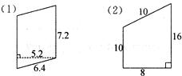

# Mathematics (Grade 5)

**ID**: 9c748010
**难度**: medium_hard
**题型**: short_answer

## 题目
计算下面各图形的面积．（单位：厘米）

## 解答

**答案**: 37.44, 104

1. Step1:根据平行四边形面积公式S=ah，其中a=7.2厘米，h=5.2厘米，可得7.2×5.2=37.44平方厘米
2. Step2:根据梯形面积公式S=(a+b)h÷2，其中a=10厘米，b=16厘米，h=8厘米，先计算10+16=26厘米，再计算26×8=208平方厘米，最后208÷2=104平方厘米

## 知识点

**知识点**:
  - 平行四边形的面积；梯形的面积．

---
