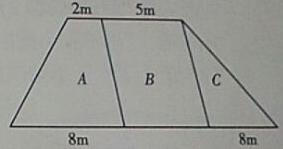

# Mathematics (Grade 5)

**ID**: 9cf609bb
**难度**: medium_hard
**题型**: short_answer

## 题目
如图：学校有一块劳动基地，A种青菜，B种西红柿，C种玉米.(1)如果种植玉米的面积是12平方米，那么种植西红柿的面积是多少平方米？ (2)如果每平方米能收青菜10千克，那么A这块地能收青菜多少千克？

 2m  5m  8m  8m

## 解答

**答案**: 15, 150

1. Step1:根据三角形面积公式$S = \frac{1}{2}ah$（$S$是面积，$a$是底，$h$是高），已知种植玉米的三角形面积是12平方米，底是8米，可得三角形的高为$12×2÷8 = 3$米，此高也是平行四边形和梯形的高
2. Step2:根据平行四边形面积公式$S = ah$（$a$是底，$h$是高），已知平行四边形的底是5米，高是3米，所以种植西红柿的平行四边形面积为$3×5 = 15$平方米
3. Step3:根据梯形面积公式$S=(a + b)h÷2$（$a$是上底，$b$是下底，$h$是高），已知梯形的上底是2米，下底是8米，高是3米，可得梯形面积为$(2 + 8)×3÷2 = 15$平方米
4. Step4:已知每平方米能收青菜10千克，梯形面积是15平方米，所以A这块地能收青菜的重量为$15×10 = 150$千克

## 知识点

**知识点**:
  - --

---
