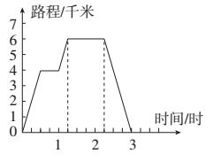

# Mathematics (Grade 5)

**ID**: 9d1ebdb3
**难度**: medium_hard
**题型**: short_answer

## 题目
下图是小华从家出发去离家6千米远的东湖游玩及返回的时间和路程的统计图，请根据统计图回答问题。
（1）小华在东湖玩了多长时间？
（2）小华回家时的平均速度是多少？

## 解答

**答案**: 1个小时, 8（千米/时）

1. Step1:观察统计图，根据解析2可知横轴把1小时平均分成4份，每份15分钟
2. Step2:对于问题（1），由解析2知小华在东湖玩的时间对应4格，计算15×4 = 60分钟，60分钟 = 1小时
3. Step3:对于问题（2），根据解析2可知小华返回用了3格时间，计算15×3 = 45分钟，将45分钟换算为$rac{3}{4}$时
4. Step4:根据速度=路程÷时间，路程为6千米，时间为$rac{3}{4}$时，计算6÷$rac{3}{4}$ = 8千米/时

## 知识点

**知识点**:
  - 单式折线统计图

---
