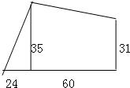

# Mathematics (Grade 5)

**ID**: 9e4c88b9
**难度**: medium_hard
**题型**: short_answer

## 题目
一块菜地(如图)，(单位：米)，如果每平方米收入30元，这块菜地共收入多少元？

## 解答

**答案**: 72000

1. Step1:计算三角形的面积，根据三角形面积公式S = 底×高÷2，底为24米，高为35米，可得24×35÷2 = 420平方米
2. Step2:计算梯形的面积，根据梯形面积公式S = (上底 + 下底)×高÷2，上底为31米，下底为35米，高为60米，可得(31 + 35)×60÷2 = 1980平方米
3. Step3:计算这块菜地的总面积，将三角形面积与梯形面积相加，420 + 1980 = 2400平方米
4. Step4:计算这块菜地的总收入，已知每平方米收入30元，用总面积乘以每平方米收入，2400×30 = 72000元

## 知识点

**知识点**:
  - 组合图形的面积．

---
