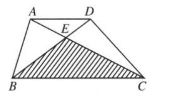

# Mathematics (Grade 5)

**ID**: 9e6709a2
**难度**: medium_hard
**题型**: short_answer

## 题目
如图，梯形ABCD的面积是45平方厘米，高6厘米，三角形AED的面积是5平方厘米，底BC是10厘米，求阴影部分的面积。

## 解答

**答案**: 20

1. Step1:根据梯形面积公式S=(a + b)×h÷2，已知梯形ABCD面积是45平方厘米，高6厘米，底BC是10厘米，先求出上底AD的长度，由45=(AD + 10)×6÷2，可得AD = 5厘米。
2. Step2:计算三角形BCD的面积，根据三角形面积公式S = a×h÷2，底BC = 10厘米，高6厘米，所以$S_{△BCD}$ = 10×6÷2 = 30平方厘米。
3. Step3:计算三角形ABE的面积，由$S_{△ABE}$ = 梯形的面积 - $S_{△BCD}$ - $S_{△AED}$，已知梯形面积45平方厘米，$S_{△BCD}$ = 30平方厘米，$S_{△AED}$ = 5平方厘米，所以$S_{△ABE}$ = 45 - 30 - 5 = 10平方厘米。
4. Step4:计算三角形ABC的面积，根据三角形面积公式S = a×h÷2，底BC = 10厘米，高6厘米，所以$S_{△ABC}$ = 10×6÷2 = 30平方厘米。
5. Step5:计算阴影部分面积，由$S_{阴影}$ = $S_{△ABC}$ - $S_{△ABE}$，$S_{△ABC}$ = 30平方厘米，$S_{△ABE}$ = 10平方厘米，所以$S_{阴影}$ = 30 - 10 = 20平方厘米。

## 知识点

**知识点**:
  - 组合图形的面积;三角形的面积

---
