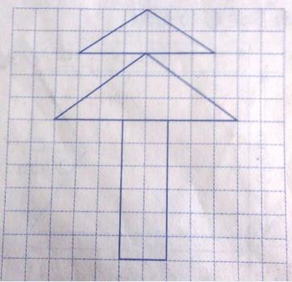

# Mathematics (Grade 5)

**ID**: 9f7d6188
**难度**: medium_hard
**题型**: short_answer

## 题目
算出下面图形的面积．(每个方格表示1cm²)

## 解答

**答案**: 30

1. Step1:观察图形，确定其由两个三角形和一个长方形组成
2. Step2:计算上面三角形的面积，其底为6cm，高为2cm，根据三角形面积公式S = 底×高÷2，可得面积为6×2÷2 = 6cm²
3. Step3:计算下面三角形的面积，其底为8cm，高为3cm，根据三角形面积公式S = 底×高÷2，可得面积为8×3÷2 = 12cm²
4. Step4:计算长方形的面积，其长为6cm，宽为2cm，根据长方形面积公式S = 长×宽，可得面积为6×2 = 12cm²
5. Step5:将两个三角形和长方形的面积相加，即6 + 12 + 12 = 30cm²
6. Step6:得出图形面积为30cm²，提取面积数值30

## 知识点

**知识点**:
  - --

---
