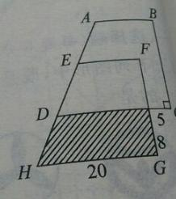

# Mathematics (Grade 5)

**ID**: a09188d5
**难度**: medium_hard
**题型**: short_answer

## 题目
如图所示，先将两个直角梯形重叠在一起，再将其中一个直角梯形沿AD的方向平移，平移距离为AE的长，求阴影部分的面积(单位:厘米)．

 5  8  20

## 解答

**答案**: 140

1. Step1:由平移的性质可知，阴影部分的面积等于空白梯形的面积
2. Step2:空白梯形的上底为20 - 5 = 15厘米
3. Step3:空白梯形的下底为20厘米
4. Step4:空白梯形的高为8厘米
5. Step5:根据梯形面积公式S=(a + b)×h÷2（其中a为上底，b为下底，h为高），可得阴影部分面积为(15 + 20)×8÷2
6. Step6:先计算括号内15 + 20 = 35
7. Step7:再计算35×8 = 280
8. Step8:最后计算280÷2 = 140平方厘米

## 知识点

**知识点**:
  - 

---
