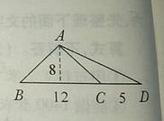

# Mathematics (Grade 5)

**ID**: a42b98b8
**难度**: medium_hard
**题型**: short_answer

## 题目
一个三角形的底长12厘米，若高不变，底边延长5厘米后，它的面积增加了多少平方厘米？

## 解答

**答案**: 20

1. Step1:明确增加部分是一个三角形，其底边长为5厘米
2. Step2:由图可知这个增加三角形的高为8厘米
3. Step3:根据三角形面积公式S = 1/2×底×高，可得增加部分面积为1/2×5×8
4. Step4:计算1/2×5×8 = 20平方厘米

## 知识点

**知识点**:
  - --

---
