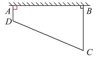

# Mathematics (Grade 5)

**ID**: a7a0b088
**难度**: medium_hard
**题型**: short_answer

## 题目
用44m长的篱笆围一块梯形菜地，如图，一面靠墙，AB长10cm，CD长24m，求这块菜地的面积。

## 解答

**答案**: 100（m$^{2}$）

1. Step1:根据篱笆长44m和CD长24m，可得梯形上底与下底的和为44 - 24 = 20m
2. Step2:已知梯形的高AB为10m，根据梯形面积公式（上底 + 下底）×高÷2，可得面积为20×10÷2
3. Step3:计算20×10÷2 = 200÷2 = 100m²

## 知识点

**知识点**:
  - 梯形的认识;梯形的面积

---
