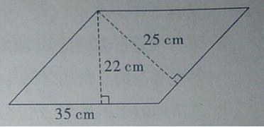

# Mathematics (Grade 5)

**ID**: b06bbeda
**难度**: medium_hard
**题型**: short_answer

## 题目
用铁丝围成如下图所示的平行四边形，至少要用多长的铁丝？

 25cm  22cm   35cm

## 解答

**答案**: 131.6

1. Step1:根据平行四边形面积公式，底乘以高，计算出面积为22×35 = 770平方厘米
2. Step2:由等面积原理，用面积除以另一条高25厘米，得到另一边的长度为770÷25 = 30.8厘米
3. Step3:根据平行四边形周长公式，计算周长为2×(30.8 + 35) = 131.6厘米

## 知识点

**知识点**:
  - --

---
