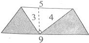

# Mathematics (Grade 5)

**ID**: b1ecaf1b
**难度**: medium_hard
**题型**: short_answer

## 题目
如图是一个梯形，下底长9厘米，图中直角三角形三条边分别长3厘米、4厘米、5厘米，阴影部分的面积是多少？

## 解答

**答案**: 10.8

1. Step1:根据直角三角形面积公式S = a×b÷2（a、b为直角边），计算空白直角三角形面积，即3×4÷2 = 6平方厘米
2. Step2:根据三角形面积公式S = c×h÷2（c为斜边，h为斜边上的高），由空白直角三角形面积反推其斜边上的高，即6×2÷5 = 2.4厘米，此高也是梯形的高
3. Step3:根据梯形面积公式S = （上底 + 下底）×高÷2，计算梯形面积，上底为5厘米，下底为9厘米，高为2.4厘米，即(5 + 9)×2.4÷2 = 16.8平方厘米
4. Step4:用梯形面积减去空白直角三角形面积，得到阴影部分面积，即16.8 - 6 = 10.8平方厘米

## 知识点

**知识点**:
  - 梯形的面积;三角形的周长和面积

---
