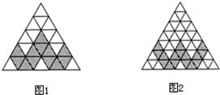

# Mathematics (Grade 5)

**ID**: b3543208
**难度**: medium_hard
**题型**: short_answer

## 题目
如图1和图2，把两个相同的正三角形的各边分别五等分和七等分，并连接这些分点．已知图1中阴影部分的面积是294平方分米．请问：图2中的阴影部分的面积是多少平方分米？

## 解答

**答案**: 200

1. Step1:分析图1，把正三角形各边五等分后，大三角形被分成了25个小三角形，阴影部分占12个，所以图1中阴影部分面积是大三角形面积的$\frac{12}{25}$，已知图1阴影部分面积为294平方分米，根据已知部分求整体，可算出大三角形面积为294÷$\frac{12}{25}$
2. Step2:分析图2，把正三角形各边七等分后，大三角形被分成了49个小三角形，阴影部分占16个，所以图2中阴影部分面积是大三角形面积的$\frac{16}{49}$
3. Step3:因为两个正三角形相同，即大三角形面积相同，那么图2阴影部分面积为大三角形面积乘以$\frac{16}{49}$，也就是294÷$\frac{12}{25}×\frac{16}{49}$
4. Step4:计算294÷$\frac{12}{25}×\frac{16}{49}$=294×$\frac{25}{12}×\frac{16}{49}$=200平方分米，得到图2阴影部分面积为200平方分米

## 知识点

**知识点**:
  - 组合图形的面积．

---
