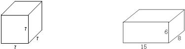

# Mathematics (Grade 5)

**ID**: b3d9d9d3
**难度**: medium_hard
**题型**: short_answer

## 题目
求下面各图的表面积和体积．（单位：cm）

## 解答

**答案**: 294, 343, 516, 720

1. Step1:根据正方体表面积公式S=6a²，其中a = 7cm，可得正方体表面积为7×7×6 = 294平方厘米
2. Step2:根据正方体体积公式V=a³，其中a = 7cm，可得正方体体积为7×7×7 = 343立方厘米
3. Step3:根据长方体表面积公式S=(ab + ah + bh)×2，其中a = 15cm，b = 8cm，h = 6cm，先计算括号内15×8+15×6+8×6 = 120 + 90 + 48 = 258，再乘以2得到258×2 = 516平方厘米
4. Step4:根据长方体体积公式V=abh，其中a = 15cm，b = 8cm，h = 6cm，可得长方体体积为15×8×6 = 720立方厘米

## 知识点

**知识点**:
  - 长方体和正方体的体积；长方体和正方体的表面积．

---
