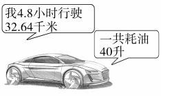

# Mathematics (Grade 5)

**ID**: b43e903f
**难度**: medium_hard
**题型**: short_answer

## 题目

（1）平均每小时行多少千米？
（2）平均每升油行多少千米？

## 解答

**答案**: 6.8, 0.816

1. Step1:根据速度=路程÷时间，计算平均每小时行驶的千米数，路程为32.64千米，时间为4.8小时，即32.64÷4.8 = 6.8千米
2. Step2:计算平均每升油行驶的千米数，用行驶的路程32.64千米除以耗油量40升，即32.64÷40 = 0.816千米

## 知识点

**知识点**:
  - 小数除法

---
