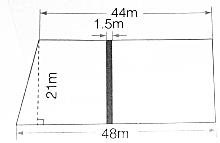

# Mathematics (Grade 5)

**ID**: ba8b036a
**难度**: medium_hard
**题型**: short_answer

## 题目
一块梯形稻田，中间有一条水渠通道．
（1）实际种植水稻的面积是多少平方米？
（2）如果每平方米稻田产水稻1.2千克，那么这块稻田共产水稻多少千克？

## 解答

**答案**: 934.5, 1121.4

1. Step1:计算平移后梯形的上底为44 - 1.5 = 42.5米
2. Step2:计算平移后梯形的下底为48 - 1.5 = 46.5米
3. Step3:根据梯形面积公式s=(a + b)×h÷2，其中a = 42.5米，b = 46.5米，h = 21米，计算实际种植水稻的面积为(42.5 + 46.5)×21÷2 = 89×10.5 = 934.5平方米
4. Step4:已知每平方米稻田产水稻1.2千克，计算这块稻田共产水稻的重量为1.2×934.5 = 1121.4千克

## 知识点

**知识点**:
  - 组合图形的面积

---
