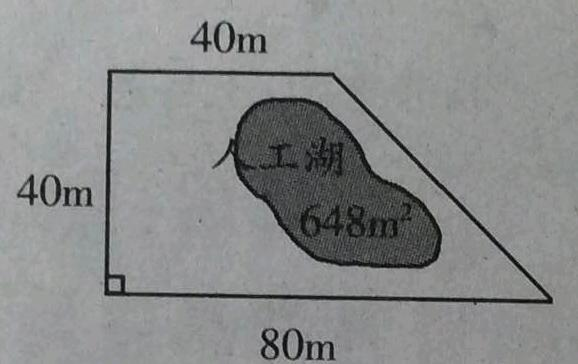

# Mathematics (Grade 5)

**ID**: bc63f035
**难度**: medium_hard
**题型**: short_answer

## 题目
人工湖的面积占梯形公园总面积的百分之几？

 40m  40m  人工湖648㎡  80m

## 解答

**答案**: 27%

1. Step1:根据梯形面积公式，梯形面积=（上底+下底）×高÷2，上底为40m，下底为80m，高为40m，可得梯形公园面积为(40 + 80)×40÷2
2. Step2:计算(40 + 80)×40÷2 = 120×40÷2 = 4800÷2 = 2400（㎡）
3. Step3:根据人工湖的面积占梯形公园总面积的百分之几等于人工湖面积除以梯形公园的面积乘以100%，已知人工湖面积为648㎡，梯形公园面积为2400㎡，可得648÷2400×100%
4. Step4:计算648÷2400×100% = 0.27×100% = 27%

## 知识点

**知识点**:
  - --

---
