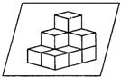

# Mathematics (Grade 5)

**ID**: bd725b5e
**难度**: medium_hard
**题型**: short_answer

## 题目
如图是由棱长为1厘米的小正方体拼合而成的，请计算这个图形露在外面的面积和是多少平方厘米？

## 解答

**答案**: 28

1. Step1:分别从前面、后面、左面、右面、上面这几个方向数露在外部的小正方形的面的数量，前面有6个，后面有6个，左面有6个，右面有5个，上面有5个
2. Step2:将各个方向露在外部的小正方形的面的数量相加，即6+6+6+5+5=28个
3. Step3:因为每个小正方体的棱长为1厘米，所以每个小正方形面的面积为1×1=1平方厘米
4. Step4:用露在外部的小正方形面的总数乘以每个小正方形面的面积，即1×1×28=28平方厘米，得到露在外面的面积和

## 知识点

**知识点**:
  - 简单的立方体切拼问题;规则立体图形的表面积．

---
