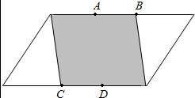

# Mathematics (Grade 5)

**ID**: be858b04
**难度**: medium_hard
**题型**: short_answer

## 题目
如图平行四边形的面积是60cm$^{2}$，A、B、C、D四个点分别把上、下两条边平均分成三段，你能求出图中阴影部分的面积吗？

## 解答

**答案**: 40

1. Step1:连接AC、AD、BD，将平行四边形分割成6个三角形
2. Step2:根据平行四边形的性质以及A、B、C、D四个点分别把上、下两条边平均分成三段，可知这6个三角形的面积都相等
3. Step3:因为阴影部分的面积等于4个这样的三角形的面积，平行四边形面积是60cm²，所以先计算每个三角形面积为60÷6 = 10平方厘米
4. Step4:进而计算阴影部分面积为10×4 = 40平方厘米

## 知识点

**知识点**:
  - 组合图形的面积

---
