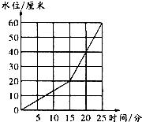

# Mathematics (Grade 5)

**ID**: c5ac227c
**难度**: medium_hard
**题型**: short_answer

## 题目
看图回答问题：
如图是水管往水箱里注水的统计图．水管装有A、B两个进水管，先开A管，过一段时间后两管同时打开．
（1）同时开放A、B两管是什么时间？当时水深多少？
（2）A、B两管同时进水每分钟水位上升多少厘米？

## 解答

**答案**: 15分钟, 20厘米, 4厘米

1. Step1:观察统计图，发现从开始注水到第15分钟，水箱内水的高度平稳上升，第15分钟后水面上升速度变快，所以得出同时开放A、B两管的时间是15分钟
2. Step2:确定15分钟时对应的水深，从统计图可知当时水深20厘米
3. Step3:计算两管同时开上升的高度，用最终水位60厘米减去15分钟时的水位20厘米，即60 - 20 = 40厘米
4. Step4:计算两管同时开所用的时间，用最终时间25分钟减去15分钟，即25 - 15 = 10分钟
5. Step5:用两管同时开上升的高度除以所用时间，得出A、B两管同时进水每分钟水位上升的高度，即40÷10 = 4厘米

## 知识点

**知识点**:
  - 单式折线统计图；从统计图表中获取信息．

---
