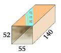

# Mathematics (Grade 5)

**ID**: c6fd552e
**难度**: medium_hard
**题型**: short_answer

## 题目
某种电冰箱包装箱（如图，单位：厘米）。做一个这样的包装箱至少要用多少平方米的纸板？

## 解答

**答案**: 3.282

1. Step1:根据长方体表面积公式（这里是5个面的面积和），先计算底面面积为55×52平方厘米
2. Step2:计算两个侧面面积之和为（52+55）×140×2平方厘米
3. Step3:将底面面积与两个侧面面积相加，得到总面积为55×52+（52+55）×140×2 = 32820平方厘米
4. Step4:因为最终结果单位要求是平方米，进行单位换算，32820平方厘米 = 3.282平方米

## 知识点

**知识点**:
  - 

---
