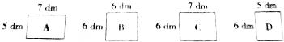

# Mathematics (Grade 5)

**ID**: c746f9e6
**难度**: medium_hard
**题型**: short_answer

## 题目

请从中选出5张铁皮，焊成一个无盖的长方体（或正方体）水箱，要使水箱的容积最大，可以怎么选？焊成的水箱的容积是多少升？（铁片的厚度忽略不计）

## 解答

**答案**: 210

1. Step1:根据长方体的特征，确定用长6分米、宽7分米的长方形作底面
2. Step2:确定用长7分米、宽5分米的两块铁皮作前后面
3. Step3:确定用长6分米、宽5分米的两块铁皮作左右面
4. Step4:得出焊成的长方体水箱的长是7分米、宽是6分米、高是5分米
5. Step5:根据长方体容积公式V = a×b×h（a为长，b为宽，h为高），计算容积为7×6×5 = 210立方分米
6. Step6:因为1立方分米 = 1升，将210立方分米换算为210升

## 知识点

**知识点**:
  - 长方体、正方体表面积与体积计算的应用

---
