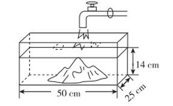

# Mathematics (Grade 5)

**ID**: cb557f61
**难度**: medium_hard
**题型**: short_answer

## 题目
一个无水的鱼缸中放有一块高为14厘米，体积为1100立方厘米的假山石（如图），如果以每分钟立方分米的流量向鱼缸内注水，那么至少需要多长时间才能将假山石完全淹没？

## 解答

**答案**: 4.1

1. Step1:将长度单位厘米换算成分米，50厘米 = 5分米，25厘米 = 2.5分米，14厘米 = 1.4分米；将体积单位立方厘米换算成立方分米，1100立方厘米 = 1.1立方分米
2. Step2:计算长5分米、宽2.5分米、高1.4分米的长方体体积，根据长方体体积公式V = a×b×h（a为长，b为宽，h为高），可得5×2.5×1.4 = 17.5立方分米
3. Step3:计算需要进水的体积，进水体积 = 长方体体积 - 假山石体积，即17.5 - 1.1 = 16.4立方分米
4. Step4:已知注水流量为每分钟4立方分米，用需要进水的体积除以注水流量，即16.4÷4 = 4.1分钟

## 知识点

**知识点**:
  - 长方体和正方体的体积

---
