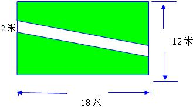

# Mathematics (Grade 5)

**ID**: cc18bf6b
**难度**: medium_hard
**题型**: short_answer

## 题目
一块长方形草地（如图），长是18米，宽是12米，中间铺了一条石子路．如果每平方米的草坪需要12元，那铺这块草坪大约需要多少钱？

## 解答

**答案**: 2160

1. Step1:根据长方形面积公式S=ab，其中a=18米，b=12米，计算长方形草地的面积为18×12=216平方米
2. Step2:根据平行四边形面积公式S=ah，其中a=2米，h=18米，计算石子小路的面积为2×18=36平方米
3. Step3:用长方形草地的面积减去石子小路的面积，得到草坪的面积为216 - 36=180平方米
4. Step4:根据“总价=单价×数量”，单价为每平方米12元，数量为草坪面积180平方米，计算铺草坪需要的钱数为180×12=2160元

## 知识点

**知识点**:
  - 组合图形的面积

---
