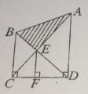

# Mathematics (Grade 5)

**ID**: cc5a90b5
**难度**: medium_hard
**题型**: short_answer

## 题目
如图，ABCD是一个直角梯形，AD和BC的和是5.6厘米，EF＝1.3厘米，三角形ABE的面积是1.43平方厘米.求直角梯形ABCD的面积.

## 解答

**答案**: 6.16

1. Step1:由三角形ABE的面积是1.43平方厘米，EF＝1.3厘米，根据三角形面积公式S = 底×高÷2的变形，可得三角形ABE以EF为高对应的底AB的长度为1.43×2÷1.3 = 2.2厘米
2. Step2:已知AD和BC的和是5.6厘米，AB为梯形的高是2.2厘米，根据梯形面积公式S=(上底 + 下底)×高÷2，可得直角梯形ABCD的面积为5.6×2.2÷2 = 6.16平方厘米

## 知识点

**知识点**:
  - --

---
