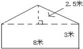

# Mathematics (Grade 5)

**ID**: ccdcea5d
**难度**: medium_hard
**题型**: short_answer

## 题目
粉刷教室的墙壁， 每平方米用白灰0.5千克，粉刷这面墙壁要用多少千克白灰？

## 解答

**答案**: 17

1. Step1:根据图可知，墙壁由一个长方形和一个三角形组成，长方形的长为8米，宽为3米，根据长方形面积公式S=长×宽，可得长方形面积为8×3 = 24平方米
2. Step2:三角形的底为8米，高为2.5米，根据三角形面积公式S=底×高÷2，可得三角形面积为8×2.5÷2 = 10平方米
3. Step3:将长方形面积与三角形面积相加，可得墙壁总面积为24 + 10 = 34平方米
4. Step4:已知每平方米用白灰0.5千克，用墙壁总面积乘以每平方米用白灰的重量，即34×0.5 = 17千克，得到粉刷这面墙壁需要用的白灰重量

## 知识点

**知识点**:
  - 组合图形的面积．

---
