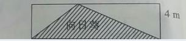

# Mathematics (Grade 5)

**ID**: ccfa17cc
**难度**: medium_hard
**题型**: short_answer

## 题目
在一个长方形花坛里，划一块三角形地种向日葵( 如下图)。如果在三角形地里种上128棵向日葵， 平均每棵向日葵占地多少平方米？

## 解答

**答案**: 0.25

1. Step1:根据长方形的长为16米，宽为4米，且三角形的底是长方形花坛的长，高是长方形的宽，由三角形面积公式S = 底×高÷2，可得三角形面积为16×4÷2 = 32平方米
2. Step2:已知三角形地里种了128棵向日葵，根据除法的意义，用三角形面积32平方米除以向日葵的棵数128，即32÷128 = 0.25平方米，得到平均每棵向日葵占地面积

## 知识点

**知识点**:
  - --

---
