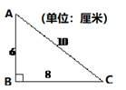

# Mathematics (Grade 5)

**ID**: ce584095
**难度**: medium_hard
**题型**: short_answer

## 题目
下图是一个直角三角形，你能求出斜边AC上的高吗？

## 解答

**答案**: 4.8厘米

1. Step1:根据直角三角形面积公式，以BC = 8厘米为底，AB = 6厘米为高，可得三角形面积为8×6×$rac{1}{2}$ = 24平方厘米
2. Step2:已知斜边AC = 10厘米
3. Step3:根据三角形面积公式变形，斜边AC上的高 = 三角形面积×2÷AC，即24×2÷10 = 4.8厘米

## 知识点

**知识点**:
  - 小学数学;图形与几何;平面图形;三角形;三角形的高及画法;三角形的面积

---
