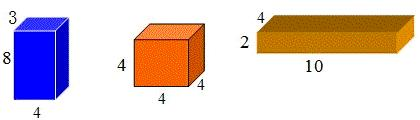

# Mathematics (Grade 5)

**ID**: d34fb9d0
**难度**: medium_hard
**题型**: short_answer

## 题目
求下面各图形的体积．(单位：分米)

## 解答

**答案**: 96, 64, 80

1. Step1:第一个图形是长方体，长为4分米，宽为3分米，高为8分米，根据长方体体积公式v = abh，可得其体积为4×3×8 = 96立方分米
2. Step2:第二个图形是正方体，棱长为4分米，根据正方体体积公式v = a³，可得其体积为4×4×4 = 64立方分米
3. Step3:第三个图形是长方体，长为10分米，宽为4分米，高为2分米，根据长方体体积公式v = abh，可得其体积为10×4×2 = 80立方分米

## 知识点

**知识点**:
  - 长方体和正方体的体积．

---
