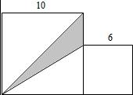

# Mathematics (Grade 5)

**ID**: da35c0b7
**难度**: medium_hard
**题型**: short_answer

## 题目
如图是由一个边长10厘米的正方形和一个边长6厘米的正方形拼成的．求阴影部分的面积．

## 解答

**答案**: 20

1. Step1:明确阴影部分是一个三角形
2. Step2:确定三角形的底为大正方形边长减去小正方形边长，即10 - 6 = 4厘米
3. Step3:确定三角形的高为大正方形的边长10厘米
4. Step4:根据三角形面积公式S = 底×高÷2，计算面积为4×10÷2 = 20平方厘米

## 知识点

**知识点**:
  - 组合图形的面积．

---
