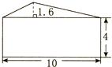

# Mathematics (Grade 5)

**ID**: dacd694a
**难度**: medium_hard
**题型**: short_answer

## 题目
有一面墙（如图），粉刷这面墙每平方米需用0.2kg涂料．一共要用多少千克涂料？（单位：m）

## 解答

**答案**: 9.6

1. Step1:根据长方形面积公式 S=长×宽，求出长方形部分面积为 10×4 = 40 平方米
2. Step2:根据三角形面积公式 S=底×高÷2，求出三角形部分面积为 10×1.6÷2 = 8 平方米
3. Step3:将三角形面积和长方形面积相加，得到这面墙的总面积为 40 + 8 = 48 平方米
4. Step4:已知每平方米需用 0.2kg 涂料，用墙的总面积乘以每平方米所需涂料量，即 48×0.2 = 9.6 千克

## 知识点

**知识点**:
  - 组合图形的面积．

---
