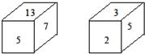

# Mathematics (Grade 5)

**ID**: e2ba8a8e
**难度**: medium_hard
**题型**: short_answer

## 题目

(2014•台湾模拟)在一粒骰子的六面上分别刻上最小的六个质数2，3，5，7，11，13，下面两图分别显示从两个不同的角度观看该骰子．如果当刻有「2」的一面向上的时候，问向下的一面刻有那一个数字﹖

## 解答

**答案**: 13

1. Step1:观察两个骰子图，找出与5相邻的数字为13、7、2、3
2. Step2:因为骰子相对面的数字是固定的，且六个面数字为2，3，5，7，11，13，所以与5相对的数字是11
3. Step3:确定与5相对的数字后，在剩下的数字中，得出与2相对的数字是13
4. Step4:当刻有‘2’的一面向上时，向下的一面是其相对面，即13

## 知识点

**知识点**:
  - 正方体的展开图．

---
