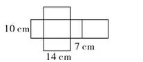

# Mathematics (Grade 5)

**ID**: e316b925
**难度**: medium_hard
**题型**: short_answer

## 题目
下面是一个长方体纸盒的展开图。做这个纸盒需要多少硬纸板？这个纸盒的容积是多少毫升？（纸盒的厚度忽略不计）

## 解答

**答案**: 616（cm$^{2}$）, 980（mL）

1. Step1:根据展开图可知长方体纸盒的长是14cm，宽是10cm，高是7cm
2. Step2:根据长方体表面积公式S=2(ab+bh+ah)，代入长14cm、宽10cm、高7cm，计算可得(10×14+10×7+7×14)×2=616（cm²）
3. Step3:根据长方体体积公式V=abh，代入长14cm、宽10cm、高7cm，计算可得10×14×7=980（cm³）
4. Step4:因为1cm³=1mL，所以980cm³=980mL

## 知识点

**知识点**:
  - 长、正方体体积的计算;体积与容积;长、正方体表面积的计算

---
