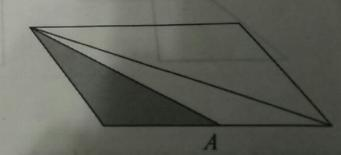

# Mathematics (Grade 5)

**ID**: e508ad62
**难度**: medium_hard
**题型**: short_answer

## 题目
一块平行四边形的草地(如图所示)，它的面积是36
 $m^{2}$
  ，底边的中点是A，阴影的三角形草地面积是多少平方米？

## 解答

**答案**: 9

1. Step1:根据平行四边形的对角线把平行四边形分成两个面积相等的三角形，可知平行四边形面积是其中一个大三角形面积的2倍，所以大三角形面积为36÷2 = 18（$m^{2}$）
2. Step2:因为底边的中点是A，那么阴影三角形与大三角形等底等高的一半，根据等底等高的三角形面积相等，可知阴影三角形面积是大三角形面积的一半，所以阴影三角形面积为18÷2 = 9（$m^{2}$）

## 知识点

**知识点**:
  - --

---
