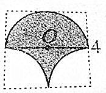

# Mathematics (Grade 5)

**ID**: e9228d52
**难度**: medium_hard
**题型**: short_answer

## 题目
求图形中阴影部分的面积．（单位：厘米）

## 解答

**答案**: 8

1. Step1:根据解析2可知，通过作辅助线并旋转①到③、②到④的位置，阴影部分面积等于正方形面积的一半
2. Step2:已知正方形边长为4厘米，根据正方形面积公式S = a×a（a为边长），可得正方形面积为4×4 = 16平方厘米
3. Step3:因为阴影部分面积是正方形面积的一半，所以阴影部分面积为16÷2 = 8平方厘米

## 知识点

**知识点**:
  - 组合图形的面积

---
