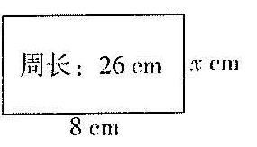

# Mathematics (Grade 5)

**ID**: ed0c043f
**难度**: medium_hard
**题型**: short_answer

## 题目
看图列方程并求解。
 一个长方形的周长为26cm,长为8cm,求它的宽。

## 解答

**答案**: 5

1. Step1:根据长方形周长公式周长=(长+宽)×2，设宽为x cm，可得(8 + x)×2 = 26
2. Step2:展开方程左边，得到16 + 2x = 26
3. Step3:方程两边同时减去16，即2x = 26 - 16
4. Step4:计算26 - 16得10，所以2x = 10
5. Step5:方程两边同时除以2，解得x = 5

## 知识点

**知识点**:
  - --解方程（3）

---
